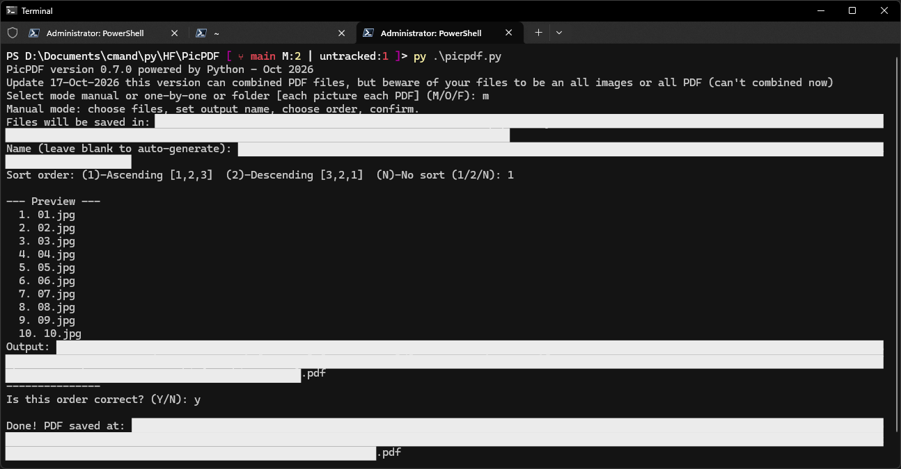
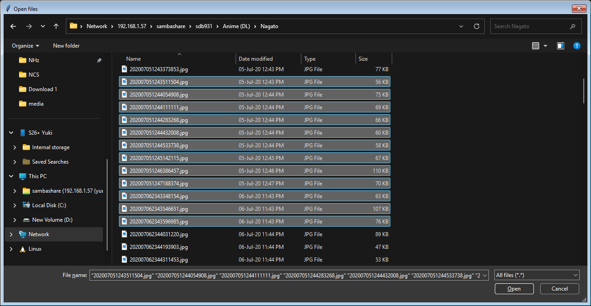
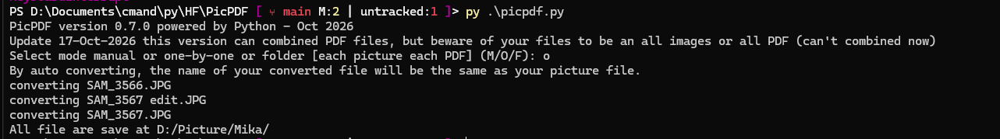
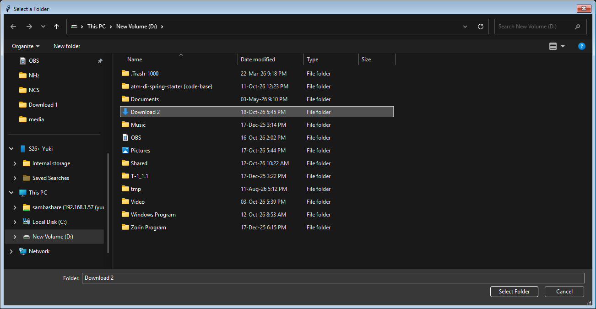

# PicPDF
Convert many files to one PDF or multiple PDF files.

*showcase image*

---

# Installation
> [!IMPORTANT]
> This Application require GUI *for select files*
1. Clone this repository
```bash
git clone https://github.com/ScUth/PicPDF.git
```
2. Install dependencies
```bash
pip install -r requirements.txt
```
3. Run the file
```bash
python picpdf.py
```
# Usage Guidelines
When running the application if nothing failed you should see select mode **manual**, **one-by-one** and **folder**

## Manual
Manual mode is the mode where you can **select any file** as you prefer either one or multiple files. 
- select file windows after mode selected.


> [!note]
> The Open files extension default is set to `*.jpg` format, you can change to `*` to select the other file extension.

- Once you finished selecting file the program will show you what path that **PDF** file is going to save. *like in the showcase image*
- Then the application will ask you for the PDF name, you can leave this field blank and the PDF name will come out as 
```c
minimum_selected_file_name - maximum_selected_file_name.pdf
// example from the showcase image
01 - 10.pdf
```
> [!note]
> Minimum and Maximum images calculated by python list with function `min()` and `max()` respectively.

- Then application will ask you about sorting order which are:
```
(1)-Ascending [1,2,3]  (2)-Descending [3,2,1]  (N)-No sort (1/2/N)
```
- Lastly application will ask the confirmation with a preview and output *like in the showcase image*. If you confirm `y` the PDF will save and finish but if you abort `n` you will loop in the sorting order selection, if you want to stop the application you can press `CTRL-C` and ignore the error.

## One-by-one
One-by-one mode is the mode where you can **select any file** as you prefer either one or multiple files, **but** unlike the manual mode this mode will convert image file to PDF file one by one, so name of the PDF file will followed the original file respectively.

- select file example:

- Once you select file, the application will convert each image to PDF immediately.
- Log example:


## Folder
Folder mode is the mode where you can **select images folder** and that folder must have only images inside

- select folder example:

- Once you finish selecting folder the application will listing the file(s) found in the folder and ask are you prefer to use folder name as a file name.
- Then application will ask you about sorting order which are:
```
(1)-Ascending [1,2,3]  (2)-Descending [3,2,1]  (N)-No sort (1/2/N)
```
- Lastly application will ask the confirmation with a preview and output *like in the showcase image*. If you confirm `y` the PDF will save and finish but if you abort `n` you will loop in the sorting order selection, if you want to stop the application you can press `CTRL-C` and ignore the error.
